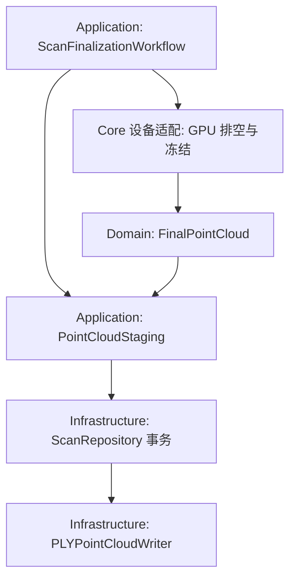

# Renderer 冻结、文件暂存与失败重试设计

2026-10-08 实施，2026-10-11 收尾。**第 63 轮代码、全量验证与独立复审完成，本轮 mergeable。** 第 62 轮报告/趋势空态、开始扫描及关闭返回的原生触摸门禁也已补齐，详见执行记录中的补验说明。真实观测回放、物理资源/精度及其余整体验收仍开放，整体目标仍 needs changes / active。

## 1. 依据与必须交付的结果

原 [整体蓝图 §5.3](REDESIGN_BLUEPRINT_2026-09-26.md#53-明确的结束扫描流程) 要求：PLY 失败保留冻结快照，重试仅执行失败阶段及后续步骤。当前实际链为：

`ScanFinalizationOperations.production.exportPointCloud → ScanCoordinator.stagePointCloud(plan:...) → Renderer.stagePointCloud async → GPU 排空/冻结 → ScanRepository.stagePointCloud → PLYPointCloudWriter`

源码检查发现两个相关问题：

1. [RendererPointCloudExport.swift](../../FruitTreeScanner/Core/RendererPointCloudExport.swift) 同时包含硬件辅助、最终云值、格式编码、分块写入和文件编排。Application 当前无法独立调用“冻结后写入”。
2. [ScanFinalizationWorkflow.swift](../../FruitTreeScanner/Application/ScanFinalizationWorkflow.swift) 仅在 combined export 成功返回后保存 `stagedPointCloud`。写文件之前已经成功冻结、随后文件失败时，没有交给 workflow 的冻结值；重试再次调用 combined export。Renderer 缓存可能复用，但它不等于 workflow 拥有的不可变重试输入。

原 `testTransientDrainAndFileFailuresRetryOriginalScanAndComplete` 在合并操作开始时注入错误，证明原 ScanID 和重试行为；它没有覆盖真实冻结成功后的文件失败。第 63 轮新增真实 Metal/生产结束链回归：首次冻结 revision 50 红色点云后因测试独占目录被普通文件阻断而失败；同 capture generation 更新为 revision 51 绿色点云，修复目录并重试。原实现退出 65，身份及内存/PLY 内容断言失败；实施后的同一回归通过。原失败结果包保留，不以预期失败方式放宽正式关卡。

本轮交付条件是：**生产结束流程明确拥有冻结值；文件失败后复用该值；Renderer 不编排文件；所有 PLY 发布继续走同一个仓储和写入器。**

## 2. 责任与依赖



| 位置 | 拥有内容 | 退出条件 |
|---|---|---|
| Domain/PointCloud/FinalPointCloud.swift | 原六个最终云字段，依赖已有 ColoredPoint 与 RendererSnapshotSignature | 独立 Domain 编译，无 Renderer/Metal/磁盘依赖 |
| Core Renderer 适配 | 捕获 generation、GPU 排空、验证、最终云冻结与缓存 | 不生成文件名、访问仓储或写文件；采样/去噪/锁顺序原样保留 |
| Application/PointCloudStaging.swift | 冻结交接值、PointCloudStageInput、StagedPointCloud、错误契约和具体文件编排 | 输入为 Sendable 值与既有仓储，I/O worker 不读取 Renderer |
| Application/ScanFinalizationWorkflow.swift | 当前扫描的冻结重试值、原有阶段/工作身份及取消清算 | 文件失败保留冻结值；估算消费实际写出的同一云；无第二生命周期 owner |
| Infrastructure/Persistence/PLYPointCloudWriter.swift | 纯格式编码、分块写出、Receipt 与文件错误 | 单一生产编码实现，保留现有独占发布和完整性契约 |
| Core RendererPLYDataBuilder 兼容面 | 已有样本类型到纯格式函数的适配 | makeData 仅服务既有兼容/测试，不用于生产整云写出 |

这些是建议文件位置；先看完整依赖闭包再落地，避免重复 Swift basename。`PointCloudExportError` 的五个 case 与原分类保持；可随 Application 契约移动，但不把硬件错误或仓储类型放入 Domain。

## 3. 明确接口与任务所有权

以下接口已在第 63 轮实现：

```swift
// Application value: one successful freeze, reusable before source publication.
struct FrozenPointCloudExport: Sendable {
    let pointCloud: FinalPointCloud
    let captureIdentity: ScanCaptureIdentity?
    let fallbackFolder: String
}

// Request fields come from the workflow's fixed plan/location, not the device.
struct PointCloudStageInput: Sendable {
    let frozen: FrozenPointCloudExport
    let treeID: String
    let latitude: Double
    let longitude: Double
}

// Hardware adapter: pins generation before creating/waiting on its worker.
func freezeFinalPointCloudForExport() async throws -> FinalPointCloud

// Application: bounded I/O, repository transaction, owned draft receipt.
static func stage(
    _ input: PointCloudStageInput,
    repository: ScanRepository
) async throws -> StagedPointCloud
```

生产 `ScanFinalizationOperations` 明确分成 freeze 与 stage 两个操作，workflow 在二者之间保存冻结值。现有 memberwise initializer 的实际源码调用者仅在 `ScanReadinessTests.swift` 和生产定义文件；迁移这些内部操作构造器时逐项保留测试意图，GPU 错误进入 freeze，文件错误进入 stage，不能机械重命名让错误出现在错误阶段。公开/兼容入口另按 §6 处理。

Coordinator 在主 actor 检查 activePlan 与 finishing，固定原 ScanContext；硬件适配返回云后，将云、captureIdentity 与 fallbackFolder 组成冻结交接值。`currentFolder` 当前仅在两个主 actor 开始/继续入口赋为 scans，却在旧 detached worker 中读取；新 I/O worker 只读取捕获的字符串。不得给 Renderer 新增 blanket unchecked Sendable。

生产 workflow 在接纳冻结值之前，要求 captureIdentity 非 nil、context 精确等于当前 ScanID/PlanID、signature 等于输入云 identity。错配值不保存、不进入 writer，并按 captureInvalid 结束，要求新扫描；这一新增接口边界需专门回归，不能改变 prepareSnapshot 阶段既有的错误与重试分类。nil capture 只保留在没有 Plan 的旧 async Renderer 兼容调用中，不能流入生产结束流程。freeze 操作只接收 Plan；stage 操作从 workflow 固定的 Plan/初始 GPS 和已接纳冻结值构造 PointCloudStageInput，不让设备回传并改写树名/GPS。保留既有非有限 GPS 编码降级，不增加 Double == 的 NaN 准入问题。

硬件 worker 保留以下实际顺序：捕获 generation → 检查取消 → 用现有 5 秒截止时间排空三个 permit → 检查取消 → 验证 generation/writeFailed → 冻结非空云 → 检查取消。nil 时继续按原顺序复查 capture，再报 emptyPointCloud。锁顺序仍为 pointBufferLock 后 snapshotLock；缓存校验仍核对完整捕获状态和 revision。GPU 排空仍是有限 semaphore 屏障，本方案不宣称已经做到即时取消。

stage 的 utility worker 只接收冻结值与现有 `ScanRepository`；仓储已有 Sendable/事务保护，不借本轮重写。两个 worker 顺序执行，取消分别向下传递，没有并行的整云复制或新增缓冲转换；增加的调度边界及 COW 物理成本仍需设备测量。

## 4. 冻结值、失败与取消状态

| 事件 | workflow 应有的冻结/草稿状态 | 后续 |
|---|---|---|
| 初次 finish | 无冻结、无 draft | freeze 一次，再 stage |
| drain timeout / 空云 | 无成功冻结、无 draft | 保留原 retry 分类，可再 freeze |
| gpuWriteFailed / captureChanged | 无可接纳冻结 | 维持原 captureInvalid，新扫描才能恢复 |
| freeze 成功，文件发布前失败 | 保存同一 FrozenPointCloudExport，无 draft | retry 只 stage，不读 Renderer/cache |
| stage 成功 | StagedPointCloud 接管同一云与 draft；释放独立冻结重试引用 | 原 prepareSnapshot/estimate/persist |
| freeze 期间取消/替换 | 迟到纯值不接纳，不存在文件可删 | 释放值，不触碰新扫描 |
| stage 发布前取消 | writer 清理自己创建的临时文件 | 不发布 draft，不删原档 |
| stage 发布后取消/owner 消失 | 必须交回 Receipt/Draft | 原 discardArtifacts/settle 路径处理，完整记录保持 |
| 文件失败后取消/reset | 清除冻结重试引用 | 新扫描不继承旧云 |

freeze 返回与 stage await 之间只进行同步的 owner/work/scan/plan 检查及值保存。不要在 stage await 前 `guard let self` 并把强 owner 留在作用域内；保留弱 owner 跨 await 的释放语义。完成 freeze 之后不再读取可变 Renderer 作为重试依据，也不以路径/mtime 代替 source identity。

文件名、scanDate、UUID 后缀仍按原规则每次写出尝试生成；不在本轮引入“碰撞时反复使用固定文件名”的新策略。冻结云、树名/GPS/上下文保持，不承诺失败尝试与重试的整份 PLY 头字节相同。输出字节兼容测试使用固定格式输入。

## 5. PLY 与事务不可变条件

- 原 header 顺序、CRLF、x/y/z 四位小数、GPS 六位小数、颜色截断和树名净化保持。格式实现只保留一份，Renderer 兼容函数委派过去。
- 默认 1024 点块，完整 writeAll/EINTR、短写错误、fsync、close、临时文件权限与清理保持；不将点云转为整份 String/Data。
- SHA-256 与 file identity 的全部可能失败操作仍在独占 rename 发布之前完成。发布后不再取消检查或抛出新增错误，保证 Receipt 必定交回。
- 仓储在原事务锁内调用 writer 并登记 draft；不从 Renderer、stager 或新 helper 独立发布文件。现有 manifest/companion 提交和取消清算不改。
- 仅 fused 的可靠产量、拒绝/低置信度深度否决、零产/扫描/置信度诊断、阈值与最终采样上限保持。

## 6. 兼容入口的退出审计

本次全仓 Swift 和非 Swift 生产搜索：Renderer.savePointCloud/callback stage、Coordinator.exportPLY/callback stage 只在兼容链内部互调；非 Swift 另有历史 patch 的仓储 stage 引用。方法没有 public/@objc 声明，仍须在实施时复查 target、脚本和函数引用后决定删除，不能把历史文档/patch 当作生产调用者，也不能仅靠方法名无调用就删其它兼容契约。

Renderer async stage 有多项实际 GPU 回归调用者。第一步保留其签名，通过 freeze + PointCloudStaging 委派；唯一文件副作用仍在 stager/仓储。生产 finalization 使用明确 split 操作，不能继续绕回 combined facade。RendererPLYDataBuilder 的 header/vertex/makeData 有现有兼容测试，先保留委派，不恢复整云生产写出。

## 7. 原实现回归与迁移验证

**先建立失败回归：** 使用真实 Renderer/生产结束操作及测试独占目录，制造冻结成功后的文件发布前失败；保留同一 capture generation，修改缓存 revision/点样本并修复目录后重试。断言持久云仍是第一次冻结的点与 identity，freeze 只成功接纳一次。旧实现应因再次取云而失败。若实际夹具不能可靠证明该边界，先修夹具与测量，不把纯 fake 的固定输出当作生产证明。

| 风险 | 现有必须保留的证据 | 必要新增覆盖 |
|---|---|---|
| GPU 排空/取消/permit | PointCloudProcessingTests 的 drain 正常/超时、真实 Metal pending write、取消、失败及 reset 回归 | 独立 freezer 与生产 split 链经过同一捕获验证；旧 stage 回归仍执行 |
| 写失败重试 | 原 transient drain/file、重复 finish、ScanID 与 retryAction 回归 | 上述失败先行用例；写失败时保留同一冻结值、stage 重试后清空多余引用 |
| owner 与晚到 | 原 late export settle、cancel propagation、已提交取消竞争 | freeze 与 stage 分别悬挂时 owner 可释放；旧值/旧 draft 不影响替换扫描 |
| 发布边界 | 原 cancelled after receipt preparation、碰撞不覆盖、bytes/SHA/fileIdentity | 在真实 publisher 返回 receipt 后取消，仍将 draft 交给 owner 唯一清算 |
| 输出与资源 | 原 CRLF/parser、采样、缓存、SOR、兼容 byte 用例 | 新纯格式与兼容适配固定输入逐字相等，I/O 输入不含 Renderer；不以估算 payload 充当物理峰值 |
| Plan 与存档 | 原 production 注入仓储/历史、分类及研究读回、snapshot/source 身份 | freeze 交接的 scan/plan/signature 错配在文件发布前拒绝；stage 使用固定请求，split 后生产链完整提交读回，保留 prepare 阶段原错误/重试语义 |

迁移前跑相关完整 passing baseline；新的行为回归单独证明原失败。实施后运行 storage + lifecycle（selector 去重）、必要 UI 回归、完整 Domain + full/Release。逐方法树核对本轮前 1166 及全部定向方法，新增类同步 selector；零失败/跳过/expected failure、运行时发布告警门禁、编译告警差异、源码冻结、PBX 唯一 Sources 和旧 dirty 保护继续执行。

## 8. 可直接使用的提示词

```text
继续原 R0–R7 重构目标。读取 AGENTS.md、默认工作流、原蓝图、第62轮最终证据及
docs/architecture/RENDERER_STAGING_DESIGN_2026-10-08.md。
第62轮原生 UI 门禁独立保持开放；本轮Renderer工作不依赖该页面。preflight保存全部范围原件，保护旧dirty；
不提交、推送或合并。检查真实finalization→coordinator→Renderer→repository→PLYwriter调用链。
首先建立“冻结成功后文件失败，重试必须复用同一冻结云”的生产回归，证明原实现失败。
将FinalPointCloud纯值移入Domain；Renderer只排空/验证/冻结；Application具体stager承接文件编排；
Infrastructure保持唯一有界PLY编码/写入。生产operations分开freeze与stage，workflow唯一拥有重试冻结值，
文件失败只重试stage，取消/reset/替换正确释放，成功后估算消费实际写出的同一云。
保留generation在GPU等待前固定、permit/锁顺序、采样/cache/revision、错误分类和原文件格式。
所有可能失败的receipt工作在发布前完成；发布后取消仍必须交回draft给原owner清算。
跨await保持弱owner，I/Oworker只接收值与现有仓储；不新增Renderer blanket unchecked Sendable，
不增加整云转换，不声称未经设备测量的内存或取消性能收益。
仅在实施时完成调用者/API/target退出审计后删无用回调，保留有真实GPU测试调用者的async兼容面。
逐项迁移内部operations测试构造器，保留旧方法及其真实意图；运行storage/lifecycle、Domain、full/Release，
核对原始方法树、告警差异、源码冻结、PBX及旧dirty保护，单独只读复审后记录交付与剩余验收。
整体目标仍包含真实观测黄金回放和物理设备/最低系统验收，不能由本轮自动通过宣布全目标完成。
```

最终证据：原实现 storage/lifecycle **565/565**；真实生产链失败回归退出 65，修复后通过；最终定向 **572/572**，全量 **1173/1173、59 类、十步全 0**，原 1166 方法和七项新增方法完整保留。Domain **45 源/iOS 16 simulator/Swift 5** 与 unsigned Release 模拟器构建通过。358 项受测源码摘要仍匹配，范围外 349 个旧源与 100 个旧 dirty 路径保持。独立只读复审无阻塞发现，本轮 **mergeable**。

全量保留两条既有 QoS 告警；编译告警位置由 11 增至 13，新增两条仅为 weak owner 测试样式提示。测试后模拟器诊断收集仍有既有 `simctl` 查找错误 72，测试/Release 本身退出 0，不将日志描述为无错误。持久目录 `/Users/reece24/Library/Logs/FruitTreeScanner/refactor-iteration63-20261008/` 保留原件、失败/修复结果包、最终报告、方法树、告警对比和复审材料。

2026-10-08/11 正常 App 的报告/趋势空态、开始扫描到新建向导、取消及完成返回首页已实际观察；2520 个 Documents 文件与 8 项偏好值摘要不变。非空结果的数值一致性仍以第 62 轮挂载测试为证据，不冒充真实扫描验收。下一轮按 [真实观测回放设计](REAL_OBSERVATION_REPLAY_DESIGN_2026-10-08.md) 执行；整体仍 **needs changes / active**，未提交、未推送、未合并。
