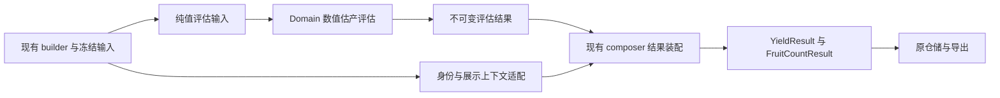

# 数值估产评估与结果装配边界设计

2026-10-07，第 56 轮后续设计稿。**第 57 轮已实施并验证**，见[执行记录](REFACTOR_ITERATIONS_2026-09-27.md#第五十七轮纯数值估产评估与三分支结果装配)。本文保留原设计契约，不关闭原 R0–R7 的结构化零产原因、真实观测、应用协作或物理验收缺口。

## 1. 已有基础与当前根因

可靠准入、计数、可见重量、单果几何质量、树冠和遮挡算法已进入 Domain，并由独立编译门禁覆盖。现有 [YieldResultComposer](../../FruitTreeScanner/Core/YieldResultComposer.swift) 仍同时承担数值计算和结果装配，并直接依赖：

- `ScanFusionYieldBuilder.Input`：包含旧 DetectedFruit 投影、Renderer 快照身份及图像诊断。
- `PointCloudCandidatePipelineOutput`：composer 实际只消费其中的 clusteringPoints。
- `ScanFusionDiagnosticsUpdater`、`ScanDiagnosticsBuilder`：混有日志、本地化和数值诊断映射。
- `YieldCalibrationContext.make`：兼容上下文的 canonical JSON 与默认模型身份。
- `FruitCategory.displayName`：展示名称；以及现有结果说明文字。

将整个混合输入原样搬入 Domain 会保留上述依赖。下一轮交付完整的**数值评估责任**，保留现有结果装配入口和输出契约。

## 2. 责任与数据流



| 边界 | 拥有的责任 | 禁止带入的依赖 |
|---|---|---|
| Domain 评估 | 可靠计数、可见重量、点云/相机覆盖、遮挡、校准后的数值、质量判断、正产/零产/未标定分支事实 | builder 类型、平台缓冲、Renderer 身份、日志、磁盘、默认模型查询、L10n、展示扩展 |
| 现有 composer 装配 | 接收评估结果、保持 YieldResult 字段与缺省值、诊断映射、说明文字、校准上下文/展示名称适配 | 第二套计数、重量、覆盖或校准算法 |
| 上游 builder | 冻结值和阶段调用顺序；非成熟季节在聚类/融合前返回 | 为评估器重新采集证据或读取活动设置 |

保留 `YieldResultComposer.compose`、`makeUncalibratedSeasonResult` 和 builder 公共入口。`YieldResultComposer.OcclusionCorrection` 如需改为领域值，可保留 typealias，避免破坏现有诊断调用者。

## 3. 纯值评估输入与输出

名称建议为 `YieldAssessmentInput`、`YieldAssessment` 和具体评估器；实施时按实际依赖选择文件边界，不新增协议或回调层。

正常估算输入至少包含下列实际数据；使用原数组/COW 值，不生成第二套点表示或额外全量转换：

| 值 | 当前来源 / 约束 |
|---|---|
| 全部点 `[ColoredPoint]` | `input.points`；保留原数量与取值 |
| 目标果实点 `[ColoredPoint]` | `pointCloudOutput.clusteringPoints`；不能换成全部点或原始筛色点 |
| 可靠证据 `[ReliableYieldEvidence]` | 原融合准入输出；不提供接受任意 ValidatedFruit 的可靠评估入口 |
| 证据观测 `[Observation]` | 原 `fusionOutput.evidenceDetections`，保持稳定/对齐筛选后的集合 |
| 候选 `[FruitCandidate]` | 当前合并与分类后的 candidates，显式来源 ID 保持 |
| 品种参数、默认品类/参数 | 原冻结快照；默认品类仍按既有 `fruitCategory ?? .apple` 语义 |
| 遮挡配置、校准 correction | 现有 Domain 配置值与 `YieldCalibrationCorrection` |
| 验证来源可靠性 | 当前诊断阶段得到的数值，保持原加权与计算时点；不得用新置信度替代 |

评估输出明确区分：原始 FruitCountResult、加权可见计数、可见重量/单果估计、完整遮挡结果、校准后的计数/重量、质量结果和分支状态。输出只描述事实；最终文字、格式与 archive 字段装配由现有边界消费。

非成熟/未标定季节保持独立的早返回路径，不为构造正常输入而提前执行聚类、融合或重量计算。两条入口的共同输出应保留该分支的特殊缺省语义。

## 4. 必须逐项固定的行为

| 契约 | 现有语义 / 回归要求 |
|---|---|
| 可靠产量 | 只消费受限准入证据；imageOnly/cloudOnly、低置信度和被拒绝深度不可重新接纳 |
| 关联和几何 | 显式候选 ID 优先、候选一次消费、品类一致、旧严格 10 cm 回退；缺失几何保留均重 fallback 和质量提示 |
| 分支判断 | 使用原加权可见计数 `> 0`，不能改为数组非空；非空证据也可能有零权重 |
| 遮挡计数输入 | 正权重时使用 `max(Int(weightedCount.rounded()), 1)`，否则为零；不可用按品类取整后的 FruitCountResult 总数替代 |
| 遮挡计数 | 先 `round(weightedCount * k)`；再对该整数乘校准 countFactor 并取整、下限为零；保留两次取整 |
| 遮挡输入 | 原目标点覆盖与整树覆盖取保守下界；原三维/二维关联、深度拒绝、方位分箱和可靠性折减保持 |
| 浮点与质量 | 重量乘法顺序、校准前基线、可见均值、coverage 降级及人工复核规则保持，不重排公式 |
| 校准身份 | 捕获的 identity 存在而 context 为 nil 时仍保持 nil；只有原正产且无 identity 的兼容路径计算 fallback，保留原调用时点，不重新查询活动模型覆盖已冻结身份 |
| 正产字段 | 原 raw/base/corrected/final 计数重量、revision/context、单果和已验证水果字段保持 |
| 成熟零产 | 原零产字段、缺省值、诊断、zeroYieldReasons 顺序和说明文字保持；不顺手填入原本为空的校准字段 |
| 非成熟未标定 | 原 manual_review/crown_untrained、专用原因、N/A、树冠与诊断保持；不套用正常分支的 cluster/校准字段装配 |
| 调用与资源 | 保留先后顺序、早返回和现有数组，纯评估不读全局设置/模型，不增加全量点拷贝 |

本轮先保持已有 `ScanDiagnosticsBuilder` 的本地化语义。完整结构化零产原因仍需后续闭环，不能把留下的字符串规则算作已经领域化。

## 5. 验收证据

1. preflight 保护所有旧 dirty，保存实际前后源码及结果树；用第 56 轮 full 的最终受测摘要核对迁移基线。
2. 先固定正产、成熟零产、未标定季节、零权重、两次取整、显式不可用校准上下文、混合点云几何、低覆盖、深度拒绝的真实输出。保留现有固定预期，不用前后两个实现互相比较代替预期断言。
3. 评估器的独立 Domain 编译只使用领域源，不能引入 Core/App/legacy、平台类型或空闭包掩盖依赖；新增源实际进入 App Sources 且唯一。
4. 关键方法包括 builder 的 empty/calibration/capturedIdentity/offSeason/lowCoverage/reliableBoundary、全部 ScanObservationReplayTests，以及相关计数/重量/遮挡测试。校准 canonical JSON 和原存档/批量回放断言保持；随机 UUID/日期不能被误当作跨运行字节黄金值。
5. 执行受影响风险 profiles、完整 iOS XCTest 和 Release；检查每个关键方法及所有运行时告警。最后代码编辑后的结果才有效。
6. 独立只读复审数值/格式适配边界、缺省/nil、可靠权限、早返回、数组所有权和完整方法树；修复阻塞后重跑受影响关卡。
7. 记录实际收益为数值合成依赖闭合。物理内存、实时扫描精度、真实观测和最低系统运行仍需独立证据；未授权不提交、推送或合并。

## 6. 第 57 轮执行提示词

```text
按默认工作流继续第57轮，读取本设计、第56轮记录和原R0–R7完成核验。
preflight保护旧dirty，用当前持久full最终源码摘要和原始方法树建立基线。
追踪YieldResultComposer完整compose/未标定早返回，以及builder/diagnostics/校准/导出消费者。
交付正产、成熟零产、非成熟未标定三分支的完整纯数值评估与现有结果装配边界。
定义明确的领域纯值输入/不可变输出，迁入计数、重量、覆盖/遮挡、校准数值和质量责任。
保留现有facade/API；它只适配冻结身份、展示字段、诊断/说明及YieldResult格式。
仅使用ReliableYieldEvidence，不扩大fileprivate构造或引入任意ValidatedFruit可靠入口。
按设计表固定原两次取整、Float运算顺序、零权重分支、候选一次消费、覆盖关联/深度否决、
nil校准上下文、各分支字段缺省与早返回；参数、阈值、schema和说明文字保持。
先建立现有固定输出基线，新增必要的边界契约回归，勿以两个新实现互证代替黄金断言。
不把builderInput、PointCloudCandidatePipelineOutput、L10n、模型查询或Core updater加入Domain。
不新增第二套大数组/点表示、空协议、闭包注入或unchecked Sendable掩盖依赖。
保留既有校准canonical字节及观测→存档→批量回放，检查Sources唯一和完整Domain递归门禁。
执行定向及full/Release，核对关键方法与最终源、独立复审并修复阻塞，记录下一轮候选。
结构化零产原因、点云编排、Plan plot/tag、应用协作、真实观测和物理资源仍按原目标推进。
不把局部数值闭合算作整体完成，不自动提交推送合并，不宣称未测的性能提升。
```
